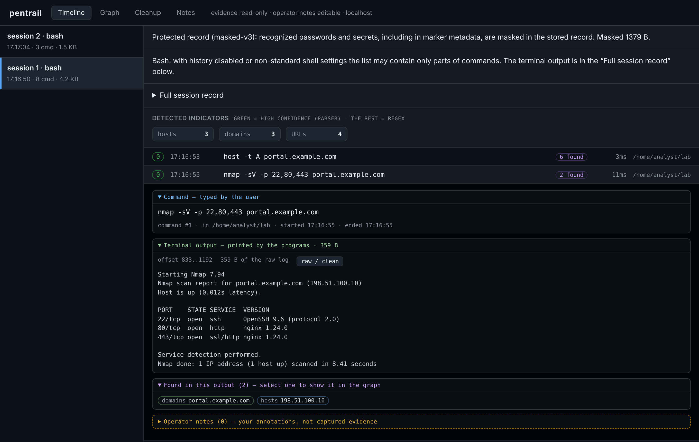

# Pentrail

Pentrail records terminal work on your own computer: every session, the
commands you typed, the output the programs printed, and what can be found in
that output (hosts, ports, URLs, findings). It stores everything in an
encrypted local database, masks recognized secrets before storing them, and
gives you a local, read-only viewer with a timeline, a relationship graph, a
cleanup checklist and operator notes.

It is meant for people who need an accurate trail of their own terminal work —
for example during an authorized security assessment, a lab exercise or
system administration — without copying it by hand.



> **Status: release candidate.** Version 0.6.29-durable is a candidate, not a
> stable release. The packages are **not code-signed**; verify them with the
> published SHA-256 checksums. The known limits of capture and masking are
> listed in [docs/LIMITATIONS.md](docs/LIMITATIONS.md).

## Features

- **Two platforms, one code base**: Windows 10 1809+ / Windows 11 (native
  ConPTY; PowerShell 5.1, PowerShell 7, CMD) and Linux x86-64 (Bash, Zsh).
- **Encrypted at rest**: SQLCipher database; the passphrase is not stored on
  disk and is not passed to the recorded shell.
- **Masking before storage**: recognized passwords, tokens, keys, credentials
  in URLs, `Authorization`/`Cookie` headers and PEM private keys are replaced
  with `*` before commands and output are written.
- **Optional automatic capture** of new terminals (`setup` + `on`/`off`), or a
  single recorded shell with `start`.
- **Local viewer**: timeline (command, output, extracted findings), graph of
  hosts/ports/URLs, full session record, cleanup checklist, operator notes.
  Bound to `127.0.0.1` and protected by a random token.
- **Encrypted backup and verification**; plaintext HTML/JSON/CSV reports only
  with an explicit `--confirm-plaintext`.

## Quick start

Download the package for your system from the release page, check its
SHA-256 (see [Verifying a download](#verifying-a-download)) and unpack it into
a new directory.

Windows (PowerShell, in the unpacked directory):

```powershell
.\pentrail.exe start --shell powershell
```

Linux:

```sh
./pentrail start --shell bash
```

Pentrail asks for the passphrase of the encrypted database (the database is
created on first use at `~/.pentrail/pentrail.db`). Work as usual. `exit`
ends the shell; `Ctrl+\` detaches and leaves the session running, and
`pentrail attach` reattaches. Then open the viewer:

```sh
pentrail open
```

The full walkthrough, including automatic capture of new terminals, is in
[docs/QUICKSTART.md](docs/QUICKSTART.md).

## Documentation

| Topic | Document |
|---|---|
| First steps on Windows and Linux | [docs/QUICKSTART.md](docs/QUICKSTART.md) |
| Using the viewer, reports and exports | [docs/USER-GUIDE.md](docs/USER-GUIDE.md) |
| Every command, flag and environment variable | [docs/COMMANDS.md](docs/COMMANDS.md) |
| Encryption, masking and their limits | [docs/DATA-PROTECTION.md](docs/DATA-PROTECTION.md) |
| Security model and trust boundaries | [docs/SECURITY-MODEL.md](docs/SECURITY-MODEL.md) |
| Known capture limitations | [docs/LIMITATIONS.md](docs/LIMITATIONS.md) |
| Backup and recovery | [docs/BACKUP-RECOVERY.md](docs/BACKUP-RECOVERY.md) |
| Windows details | [docs/WINDOWS.md](docs/WINDOWS.md) |
| Linux details | [docs/LINUX.md](docs/LINUX.md) |
| Architecture | [docs/HOW-IT-WORKS.md](docs/HOW-IT-WORKS.md) |
| Session transport | [docs/SESSION-TRANSPORT.md](docs/SESSION-TRANSPORT.md) |
| Running the tests | [docs/TESTING.md](docs/TESTING.md) |
| Building and verifying release packages | [docs/RELEASING.md](docs/RELEASING.md) |
| Release notes | [docs/RELEASE-NOTES.md](docs/RELEASE-NOTES.md) |
| Frequently asked questions | [docs/FAQ.md](docs/FAQ.md) |

## Verifying a download

Release packages are unsigned. Each release lists the SHA-256 of every
package in `SHA256SUMS`. Compare it before unpacking:

```powershell
Get-FileHash .\pentrail-<version>-windows-amd64.zip -Algorithm SHA256
```

```sh
sha256sum -c SHA256SUMS
```

A matching checksum shows that the file is the one listed in the release; it
does not prove who built it. You can build the same packages yourself from
the tagged sources ([docs/RELEASING.md](docs/RELEASING.md)).

## Building from source

Go 1.27.3 (the version in the `toolchain` line of `go.mod`; `go.mod` requires
at least Go 1.25.0) and a C compiler (CGO) are needed for the encrypted build:

```sh
CGO_ENABLED=1 go build -tags sqlcipher -o pentrail ./cmd/pentrail
```

On Windows use a MinGW-w64 `gcc` (or `zig cc`) and `-o pentrail.exe`.
Without `-tags sqlcipher` the database is **not encrypted**; that build is
for development with synthetic data only and requires `--allow-plain` for
`setup`/`on`.

## Responsible use

Record only systems and sessions you are authorized to work on. The record can
contain targets, addresses, findings and secrets that masking did not
recognize; treat the database, backups and any plaintext report as
confidential. See [SECURITY.md](SECURITY.md) for how to report a
vulnerability.

## License

Pentrail is released under the [MIT License](LICENSE). Release binaries also
contain third-party code (the Go runtime, SQLite/SQLCipher and its bundled
crypto code, Go modules and the C runtime); their licenses are in
[THIRD-PARTY-NOTICES.txt](THIRD-PARTY-NOTICES.txt), [NOTICE](NOTICE) and, in
binary packages, the `licenses/` directory.
