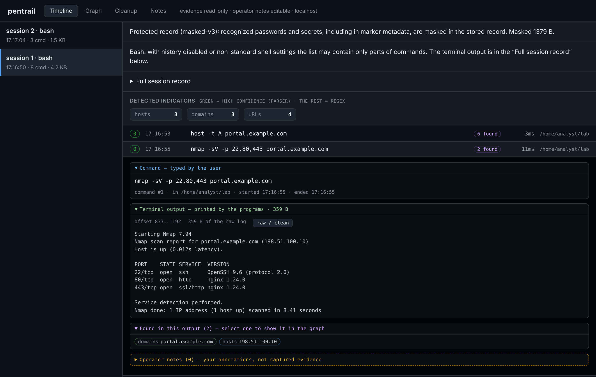
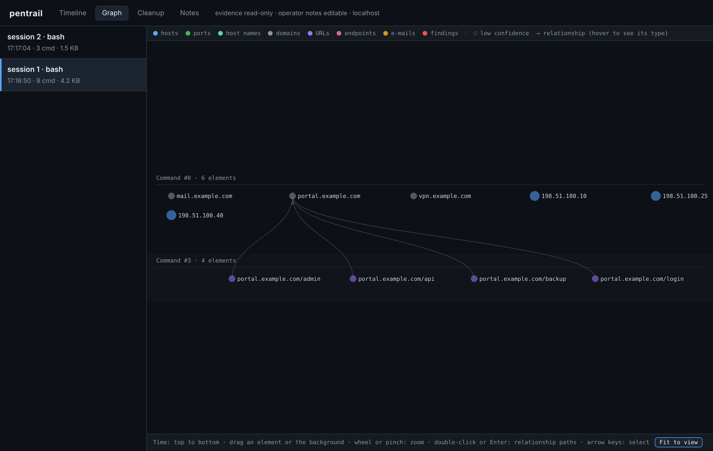
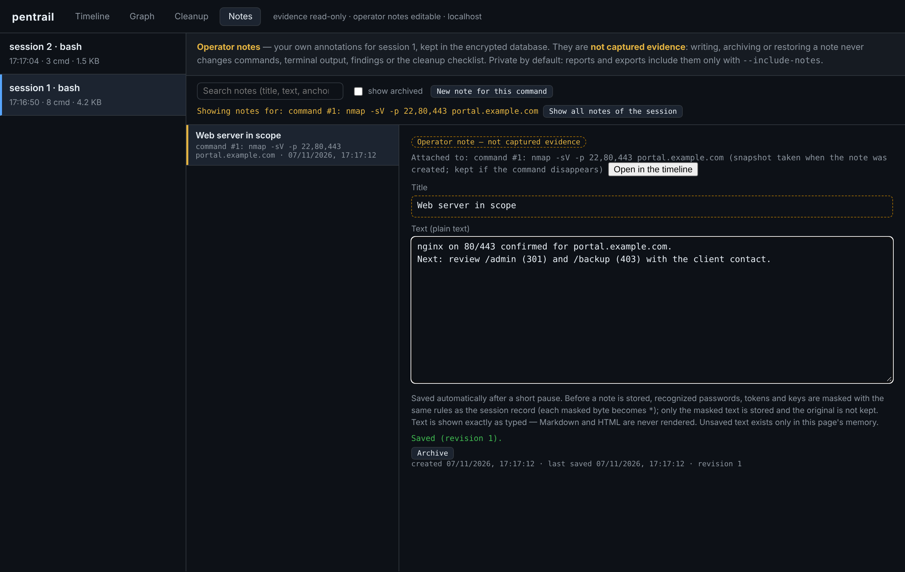

# User guide

This guide describes the viewer and the commands you use after a session has
been recorded. For first steps see [QUICKSTART.md](QUICKSTART.md); for every
flag see [COMMANDS.md](COMMANDS.md).

## Opening the viewer

```sh
pentrail open                # configured database, opens the browser
pentrail open --no-browser   # print the link only
pentrail serve --db PATH     # a viewer for a specific database in the foreground
```

The viewer listens on `127.0.0.1` (port 7878 by default for `serve`) and
prints a link that contains a random access token. Without the token the
viewer refuses every request. When the viewer is restarted, a new token is
created and old links stop working; open the newly printed link.

Captured evidence is **read-only** in the viewer. The only thing it writes is
operator notes.

The left column lists the sessions of the database. Selecting a session opens
it in the current tab: **Timeline**, **Graph**, **Cleanup** or **Notes**.

## Timeline



Each command opens into collapsible parts:

- **Command — typed by the user**: the command text, working directory,
  start and end time, exit code when it was observed.
- **Terminal output — printed by the programs**: the output range assigned to
  this command, shown with terminal control sequences removed. `raw / clean`
  switches to the stored (masked) stream including control sequences and
  back.
- **Found in this output**: hosts, ports, URLs and findings extracted from
  the output. Selecting one opens the graph with it selected.

Below the commands, **Full session record** loads the whole terminal stream
of the session in parts. It is the authoritative record: the split into
commands is derived from shell markers and can be incomplete (see
[LIMITATIONS.md](LIMITATIONS.md)). If bytes are missing from the stored
stream, the viewer shows a warning with their number instead of hiding the
gap.

## Graph



The graph shows hosts, ports, URLs and findings and how they relate. It is
laid out in bands from top to bottom by the number of the command that first
found each element; a parent (for example a host) keeps its children (its
ports) next to it.

- Pointing at or selecting an element highlights its direct relationships
  and dims the rest. The detail panel lists the relationships in both
  directions and the command(s) that found the element, with a preview of
  their output (up to 64 KiB). **Open in the timeline** jumps to the command.
- Dragging moves an element until the view is reopened. Drag the background
  to pan; zoom with the wheel or `+`/`-`; `0` or **Fit to view** fits the
  graph.
- A double click (or `Enter` on the selection) filters the paths through an
  element; **Show the whole topology** (or `Escape`) restores everything.
- Keyboard: arrow keys select the nearest element in that direction,
  `Shift`+arrow keys pan. Touch: tap selects, one finger drags, two fingers
  zoom, double tap filters.

## Cleanup

The **Cleanup** tab lists state changes found in the recorded commands that
you may need to undo on the target: files written, configuration and
permission changes, accounts, services and scheduled tasks. It is a
heuristic checklist built from the command text, not a proof that nothing
else changed.

Ticks are stored in the browser (local storage) under a random identifier of
the database, so they are per browser and per database. If the viewer cannot
read the checklist or that identifier, it says so and offers **Try again**; it
never shows an unreadable checklist as "no changes".

`pentrail cleanup` prints the same checklist in the terminal.

## Operator notes



Notes are your own plain-text annotations for a session, a command or a
graph element (**Add note** in the timeline or in the graph details, or the
**Notes** tab). They are labelled everywhere as annotations, not captured
evidence.

- Notes are stored in the same encrypted database. Text not yet saved exists
  only in the open page's memory, never in browser storage or files.
- Saving is automatic after a short pause and shows *Saving*, *Saved* or
  *Not saved* (with **Retry**). A note is only shown as *Saved* after the
  viewer confirmed the write.
- Every save names the revision it is based on. If the note was changed in
  another tab meanwhile, nothing is overwritten: your text is kept and you
  choose **Load the saved version** or **Save my text over it**.
- Notes are archived and restored, never deleted by the viewer.
- Recognized secrets in a note are masked before it is stored.

## When something cannot be loaded

Every read of the viewer is bounded (15 seconds for the main reads). If a
read fails — the viewer was stopped, the link expired (HTTP 401), the server
reported an error, or the reply was not valid — the page shows what failed
and a **Try again** button instead of loading forever. Optional data (for
example notes shown in the timeline) is reported as unknown, not as empty.

## Reports and exports

```sh
pentrail report --confirm-plaintext --session 3 --out report-3.html
pentrail export --confirm-plaintext --session 3 --format json --out session-3.json
pentrail export --confirm-plaintext --session 3 --format csv  --out session-3.csv
```

Reports and exports are plaintext files. Recognized secrets are masked, CSV
fields that a spreadsheet would read as formulas are neutralized, and an
existing file is never overwritten. Operator notes are included only with
`--include-notes` (HTML and JSON; CSV refuses it).

## Other commands

- `pentrail inspect` prints sessions, commands and statistics of the record.
- `pentrail extract` and `pentrail parse` refresh the extracted findings
  (indicators found by regular expressions; nmap XML, ffuf JSON and nuclei
  JSONL output files). The viewer runs them automatically when it starts.
- `pentrail flush` asks running sessions to commit queued output.
- `pentrail status` shows whether recording is enabled, whether the key is
  unlocked, and the state of each live session.
